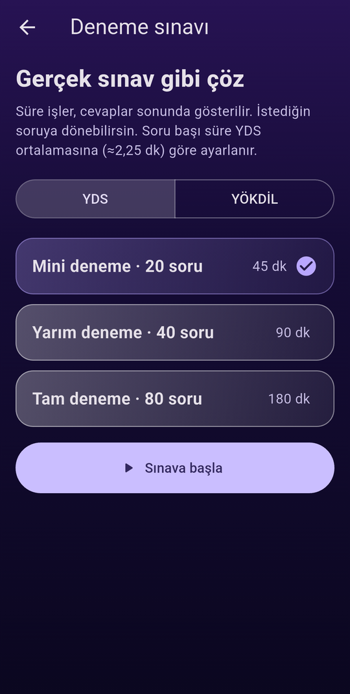
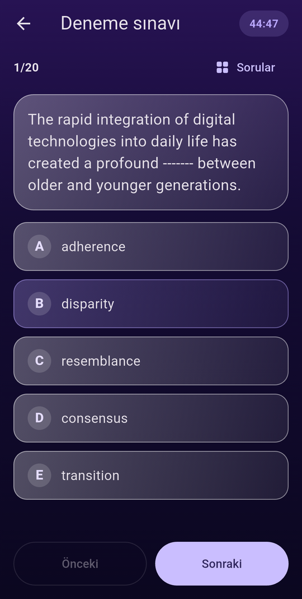

# YDS Uzmanı

**YDS / YÖKDİL** sınavlarına hazırlanmak için geliştirilmiş, açık kaynak, Flutter tabanlı bir çalışma uygulaması. Sorular, kelime listesi ve kodun tamamı serbestçe kullanılabilir.

Amaç basit: **kelimeyi bir kez gör, yanlış yaptığın şeyi tam unutmak üzereyken tekrar karşına çıkar.** Bunun için bilimsel olarak en iyi sonuç veren aralıklı tekrar algoritmalarından biri olan **FSRS** kullanılıyor.

## Ekran görüntüleri

<table>
  <tr>
    <td width="33%" align="center" valign="top">
      <br />
      <b>Ana Sayfa</b><br />
      <sub>Seri, XP, günlük hedef ve "Bugünün planı". Zayıf konulara tek dokunuşla test.</sub>
    </td>
    <td width="33%" align="center" valign="top">
      <br />
      <b>Müfredat</b><br />
      <sub>YDS / YÖKDİL kategorileri ve konu bazlı hazır olma yüzdesi.</sub>
    </td>
    <td width="33%" align="center" valign="top">
      <br />
      <b>Test öncesi kelime çalışması</b><br />
      <sub>Testteki kelimeler, anlamı ve örnek cümlesi. Bilmediklerini deftere ekle, sonra testi çöz.</sub>
    </td>
  </tr>
  <tr>
    <td width="33%" align="center" valign="top">
      <br />
      <b>Soru ve açıklama</b><br />
      <sub>Cevaptan sonra Türkçe açıklama, kelimenin anlamı ve dinleme düğmeli örnek cümle. Soru başı süre sayacı.</sub>
    </td>
    <td width="33%" align="center" valign="top">
      <br />
      <b>Yanlış defteri</b><br />
      <sub>Yanlış yapılan sorular, doğru cevap ve kelime bilgisi. "Test çöz" yanlışları ve ikizlerini sorar.</sub>
    </td>
    <td width="33%" align="center" valign="top">
      <br />
      <b>Setlerim ve kelime defteri</b><br />
      <sub>Aralıklı tekrar (FSRS) ile çalışılan kelime defterin ve kart setleri.</sub>
    </td>
  </tr>
  <tr>
    <td width="33%" align="center" valign="top">
      <br />
      <b>Deneme sınavı kurulumu</b><br />
      <sub>Mini (20), yarım (40) ve tam (80 soru) deneme; süre soru sayısına göre ayarlanır.</sub>
    </td>
    <td width="33%" align="center" valign="top">
      <br />
      <b>Deneme sınavı</b><br />
      <sub>Geri sayım, soru haritası ve cevabı geri alma. Sonuç ve kategori analizi sınav bitince.</sub>
    </td>
    <td width="33%"></td>
  </tr>
</table>

## Özellikler

- **Test öncesi kelime çalışması:** Her 10 soruluk testten önce, o testteki kelimeler (anlam + örnek cümle) ve soru metnindeki diğer zor kelimeler listelenir. Bilmediklerini deftere eklersin, sonra testi çözersin.
- **Kelime defteri + FSRS tekrar:** Kelimeler aralıklı tekrarla çalışılır. Yanlış yaptığın kelime aynı gün tekrar sorulur, ertesi güne planlanır; tekrar yanlış yaparsan yeniden kısa aralığa düşer. Her butonun altında bir sonraki tekrar zamanı görünür.
- **Yanlış defteri:** Yanlış yapılan soruların doğru cevabı, kelimenin anlamı ve örnek cümlesi. "Test çöz" yanlışlarını ve aynı konulardan benzer soruları karıştırır. "Benzer üret" Gemini ile yanlış yaptığın kelimelere benzer yeni sorular yazar.
- **Deneme sınavı:** Mini (20), yarım (40) ve tam (80 soru) deneme; soru başı YDS ortalamasına (≈2,25 dk) göre geri sayım, soru haritası, cevabı geri alma. Sonunda doğru/yanlış/boş, kategori analizi ve yanlışların açıklaması. Yanlışlar kelime ve yanlış defterine otomatik girer.
- **Günlük plan:** Ana sayfada "Bugünün planı": kelime tekrarı, günlük soru hedefi, en zayıf konudan 5 soru ve sınava 60 günden az kaldıysa haftalık deneme.
- **Zayıf konularımdan test:** En düşük başarılı 3 konudan tek dokunuşla 10 soruluk test.
- **Soru süresi:** Her soruda süre tutulur; okuma, cloze ve çeviri sorularında hedef süre daha uzundur, aşınca sayaç uyarı rengine döner. Konu başına ortalama süre kaydedilir.
- **Telaffuz:** Kelimeleri ve örnek cümleleri cihazın İngilizce ses motoruyla dinle (internet gerekmez).
- **Günlük hatırlatma:** Profil'den saat seç, her gün "kelime tekrarın var" bildirimi gelsin.
- **İkiz (yedek) sorular:** Her soru için aynı kelimeyi farklı cümlede test eden bir yedek soru. Yanlış defteri testi, yanlış yaptığın sorunun yanında ikizini de sorar; böylece cevabı ezberlemek yerine kelimeyi öğrenirsin.
- **Sınav tarihine göre planlama:** Sınav tarihini girersin, tekrar aralıkları sınavı aşmayacak şekilde kısalır.
- **YDS ve YÖKDİL müfredatı:** Kelime, gramer, cloze, okuma, çeviri, diyalog ve YÖKDİL alan kategorileri (fen, sağlık, sosyal), konu bazlı ilerleme.
- **Yarım kalan test kaldığı yerden devam eder.** İlerleme, XP, seri ve defter cihazda saklanır.
- **Gemini ile soru üretimi:** Konu, seviye ve adet seç, uygulama içinden soru üret (kendi API anahtarınla, ücretsiz katmanla çalışır).
- **Hazır soru bankası:** [assets/seed/questions.json](assets/seed/questions.json) içinde yüzlerce hazır soru, her birinde test edilen kelime, Türkçe anlamı, örnek cümle ve soru metnindeki zor kelimeler var.

## Hızlı başlangıç

Gereksinimler: [Flutter SDK](https://docs.flutter.dev/get-started/install) (stable) ve bir Android cihaz/emülatör.

```bash
git clone https://github.com/MelihAliCagman/Yds-Uzmani.git
cd Yds-Uzmani
flutter pub get
flutter run
```

Hazır soru bankası ile uygulama **API anahtarı olmadan** çalışır. Sadece uygulama içinden soru üretmek ve "Benzer üret" için anahtar gerekir.

### Gemini API anahtarı (isteğe bağlı)

1. [Google AI Studio](https://aistudio.google.com/apikey) üzerinden ücretsiz bir anahtar al.
2. `env.example.json` dosyasını `env.json` adıyla kopyala ve anahtarını yaz:
   ```json
   { "GEMINI_API_KEY": "AIza..." }
   ```
3. Anahtarı derleme anında vererek çalıştır:
   ```bash
   flutter run --dart-define-from-file=env.json
   ```

> **Güvenlik:** `env.json` `.gitignore` içindedir ve repoya girmez. Anahtarını asla commit'leme, paylaşma ya da koda gömme. Release APK'yı başkalarına dağıtacaksan anahtarı bir backend/proxy arkasına taşı: derlenmiş uygulamadan anahtar çıkarılabilir.

APK almak için: `flutter build apk --release --dart-define-from-file=env.json`

## Soru ve kelime üretme araçları

Soru bankasını büyütmek için iki script var (kendi anahtarınla çalışır, ücretsiz katmanın dakikalık/günlük limitine uyar, kota dolunca durur):

```bash
# Tüm konulara sırayla soru üretir, her istekten sonra assets/seed/questions.json'a kaydeder
dart run tool/generate_questions.dart 100      # konu başına en fazla 100 soru

# --watch: günlük kota dolunca çıkmaz, 15 dk'da bir dener; kota yenilenince kendiliğinden devam eder
dart run tool/generate_questions.dart 100 --watch

# Her soru için "ikiz" (aynı kelime, farklı cümle) yedek soru üretir -> assets/seed/twins.json
dart run tool/generate_twins.dart --watch

# Kelime listesi (glossary) eksik sorulara zor kelimeleri ekler
dart run tool/enrich_glossary.dart
```

Üreticiler aynı anda tek örnek çalışır (kilit dosyası), yarım dosya bırakmaz (geçici dosya + yer değiştirme) ve Ctrl+C ile güvenle durdurulabilir. Yeni üretilen sorular uygulamaya bir sonraki derlemede girer.

Üretilen her soru doğrulanır: tam 5 farklı şık, geçerli doğru cevap, dolu açıklama, tekrar eden soru yok. Yine de **sorular yapay zekâ ile üretilmiştir ve hata içerebilir**; şüphelendiğin sorularda resmi kaynaklara ve ÖSYM kılavuzuna bak. Hatalı bir soru bulursan issue açman çok yardımcı olur.

## Tekrar algoritması (FSRS)

Uygulama [FSRS-4.5](https://github.com/open-spaced-repetition/awesome-fsrs/wiki/The-Algorithm) (Free Spaced Repetition Scheduler) kullanır. Klasik SM-2'ye göre aynı hatırlama oranı için daha az tekrar gerektirir. Her kelime için **stabilite** (unutma hızı) ve **zorluk** ayrı hesaplanır, hedef hatırlama oranı %90'dır.

- Yeni kelime: Tekrar/Zor → 10 dk sonra; İyi/Kolay → günler sonra.
- Yanlış → kelime tekrar öğrenme adımına düşer, 10 dk sonra aynı oturumda gelir.
- Doğru → aralık, zorluğa ve tam zamanında hatırlayıp hatırlamadığına göre büyür.
- Sınav tarihi seçiliyse aralıklar sınava kalan sürenin yarısını geçmez.

Uygulama: [lib/core/srs/fsrs.dart](lib/core/srs/fsrs.dart), testler: [test/widget_test.dart](test/widget_test.dart).

## Proje yapısı

```
lib/
├── app/             # tema, router, alt gezinme
├── core/
│   ├── ai/          # Gemini istemcisi (JSON çıktı + doğrulama)
│   ├── srs/         # FSRS ve SM-2
│   ├── data/        # müfredat iskeleti, başlangıç verisi
│   ├── vocab.dart   # kelime defteri, sınav tarihi
│   └── providers.dart
└── features/        # home, curriculum, quiz, vocab, wrong, flashcards, generator, ...
assets/seed/         # hazır soru bankası (questions.json)
tool/                # soru üretme scriptleri
docs/                # ekran görüntüleri ve ilk tasarım notları (TASARIM.md)
```

Teknoloji: Flutter, Riverpod, go_router, dio, shared_preferences. Veriler şimdilik cihazda `shared_preferences` ile saklanır. Planlanan sıradaki işler için bkz. [docs/TASARIM.md](docs/TASARIM.md).

## Yol haritası

- [x] Deneme sınavı modu (süreli, kategori analizli)
- [x] Günlük çalışma planı ve zayıf konu testi
- [x] Kelime telaffuzu (TTS) ve günlük hatırlatma bildirimi
- [x] Her soru için yedek (ikiz) soru
- [ ] Deneme geçmişi grafikleri (fl_chart) ve konu bazlı gelişim
- [ ] Okuma pratiği: uzun paragraf soruları ve süreli okuma modu
- [ ] Drift/SQLite'a geçiş, web sürümü ve bulut senkronizasyonu

Katkılar memnuniyetle karşılanır: hatalı soru bildirimi, yeni soru/kelime, çeviri düzeltmesi, kod. Bir issue ya da pull request açman yeterli.

## Uyarılar

- Bu proje resmi bir ÖSYM ürünü değildir. Sınav formatı ve içeriği için daima güncel ÖSYM kılavuzuna bak.
- Sorular özgün olarak üretilmiştir, kitaplardan veya çıkmış sorulardan kopyalanmamıştır. Katkı yaparken de telifli kaynaklardan birebir metin ekleme.
- Gemini API kullanım koşullarına ve kota limitlerine uy.

## Lisans

[MIT](LICENSE). Kod ve soru bankası dahil serbestçe kullanabilir, değiştirebilir ve paylaşabilirsin.
